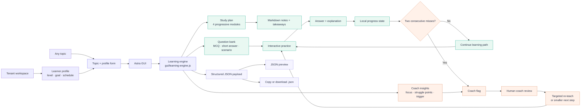

# Astra architecture

This diagram shows the current offline-first learning loop. The browser UI collects a topic and learner profile, the local learning engine produces the structured JSON contract, and the practice evidence can trigger a human coach review.

## Runtime boundaries

- **Tenant and learner context:** represented in the workspace UI; persistence and authentication are deferred.
- **Learning engine:** deterministic and offline in this prototype. It can later be replaced behind the same `generateLearningExperience(profile)` interface.
- **Practice state:** kept in browser memory for the current session.
- **Coach handoff:** triggered by the local rule of two consecutive misses, while the coach retains decision authority.
- **Payload:** follows the documented `topic_metadata`, `study_plan`, `question_bank`, and `coach_insights` contract.
